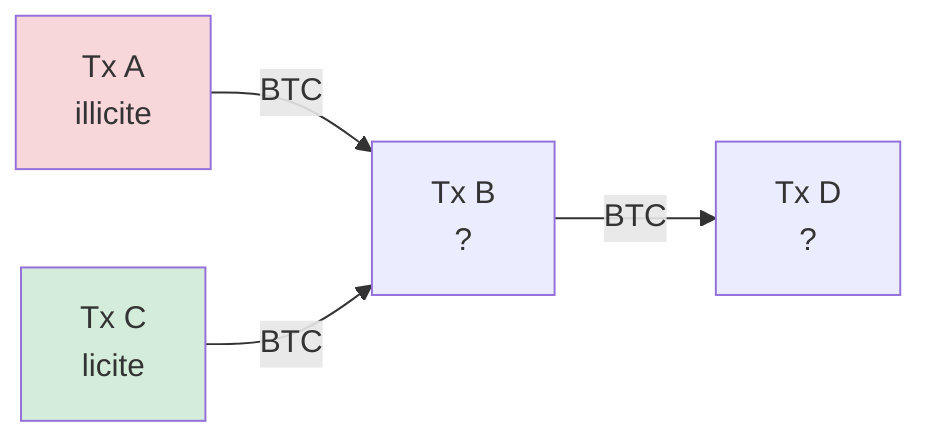
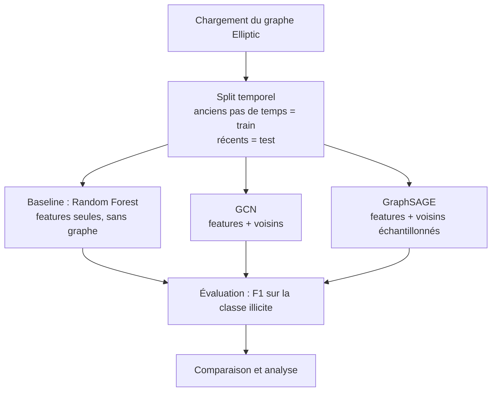

# Détection de fraude Bitcoin par Graph Neural Networks

Classification de transactions Bitcoin **licites / illicites** à partir du graphe des transactions, en comparant un modèle classique (Random Forest) à des Graph Neural Networks (GCN, GraphSAGE, GAT).

**Stack :** Python · PyTorch · PyTorch Geometric · scikit-learn

## Installation

```bash
pip install -r requirements.txt
```

Les données (≈ 700 Mo) ne sont pas versionnées. Télécharger le dataset sur [Kaggle](https://www.kaggle.com/datasets/ellipticco/elliptic-data-set) et placer les trois fichiers à la racine du projet :

```
elliptic_txs_classes.csv
elliptic_txs_edgelist.csv
elliptic_txs_features.csv
```

Puis exécuter `main.ipynb` de haut en bas. La première exécution prend ≈ 40 min sur CPU (≈ 22 min d'entraînement des GNN et ≈ 15 min de tuning du Random Forest). Ces deux étapes sont ensuite mises en cache dans `cache/` : les exécutions suivantes prennent quelques minutes. Pour forcer un recalcul, passer `TRAIN_GNN` ou `RUN_TUNING` à `True` dans la cellule « Options d'exécution ».

---

## 1. Le problème

Les transactions Bitcoin sont publiques mais pseudonymes : on voit l'argent circuler sans savoir qui est derrière. Certaines transactions sont liées à des activités illicites (ransomware, marchés du darknet, arnaques, blanchiment).

**Objectif :** prédire automatiquement si une transaction est illicite, uniquement à partir des données de la blockchain.

## 2. Pourquoi un graphe ?

Une transaction ne vit pas seule : l'argent qu'elle reçoit vient d'autres transactions, et l'argent qu'elle envoie part vers d'autres. Si une transaction reçoit des fonds d'une transaction illicite, elle est plus suspecte.

On modélise donc les données comme un **graphe** :

| Élément du graphe | Signification |
|---|---|
| **Nœud** | Une transaction Bitcoin |
| **Arête** | Un flux de bitcoins d'une transaction vers une autre |
| **Features du nœud** | Caractéristiques de la transaction (montants, frais, nombre d'entrées/sorties…) |
| **Label** | Licite, illicite ou inconnu |

Un modèle classique (Random Forest) ne regarde que les features de chaque transaction, **isolément**.
Un GNN regarde aussi **les voisins** : chaque nœud agrège l'information des transactions auxquelles il est connecté. C'est cette différence que le projet mesure.



*Le GNN utilise le fait que B reçoit des fonds de A (illicite) pour affiner sa prédiction sur B.*

## 3. Le dataset : Elliptic Bitcoin

Publié par l'entreprise Elliptic avec le MIT-IBM Watson AI Lab (Weber et al., 2019).

- **203 769** transactions (nœuds)
- **234 355** flux de paiement (arêtes)
- **166** features par transaction : 94 features locales (la transaction elle-même) + 72 features agrégées (statistiques sur les voisins)
- **49 pas de temps** (environ 2 semaines chacun)
- Labels : **2 %** illicites, **21 %** licites, **77 %** inconnus

Source : [Kaggle – Elliptic Data Set](https://www.kaggle.com/datasets/ellipticco/elliptic-data-set) (également disponible directement via `torch_geometric.datasets.EllipticBitcoinDataset`).

## 4. Démarche



**Étape 1 — Préparation.** Chargement du graphe, suppression des nœuds non labellisés pour l'entraînement et l'évaluation (ils restent dans le graphe pour la propagation de l'information).

**Étape 2 — Split temporel.** Le modèle est entraîné sur les premiers pas de temps et testé sur les suivants. C'est plus réaliste qu'un split aléatoire : en conditions réelles, on prédit le futur à partir du passé.

**Étape 3 — Baseline.** Un Random Forest sur les features seules. Il sert de point de référence : un GNN n'a d'intérêt que s'il fait mieux.

**Étape 4 — GNN.** Deux architectures à 2 couches :
- **GCN** : chaque nœud fait une moyenne pondérée des features de ses voisins.
- **GraphSAGE** : chaque nœud combine ses propres features avec un agrégat de ses voisins, ce qui généralise mieux à de nouveaux nœuds.

**Étape 5 — Gestion du déséquilibre.** Avec seulement 2 % de transactions illicites, un modèle qui prédit « licite » partout aurait déjà ~90 % d'accuracy. On utilise une **loss pondérée** pour donner plus de poids à la classe minoritaire.

**Étape 6 — Évaluation.** La métrique principale est le **F1-score de la classe illicite** (plus précision et rappel), car c'est la classe qu'on cherche à détecter. L'accuracy n'est pas utilisée car elle est trompeuse ici.

## 5. Résultats

F1, précision et rappel de la classe illicite sur le test (pas 35–49). Moyenne ± écart-type sur 3 graines (1 seule pour GAT).

| Modèle | Précision (illicite) | Rappel (illicite) | F1 (illicite) |
|---|---|---|---|
| Random Forest (features locales) | 0,855 ± 0,016 | 0,707 ± 0,003 | 0,774 ± 0,004 |
| **Random Forest (toutes les features)** | 0,930 ± 0,006 | **0,723 ± 0,003** | **0,814 ± 0,001** |
| GCN | 0,774 ± 0,045 | 0,443 ± 0,023 | 0,563 ± 0,027 |
| GraphSAGE | 0,736 ± 0,058 | 0,564 ± 0,044 | 0,638 ± 0,042 |
| GAT | 0,672 | 0,515 | 0,583 |
| RF (features + embeddings GraphSAGE) | **0,967 ± 0,007** | 0,696 ± 0,004 | 0,810 ± 0,001 |

*Protocole : pas 1–34 = train, 35–49 = test (16 670 transactions labellisées, dont 1 083 illicites). 157 features après nettoyage, standardisées sur le train. Random Forest : 50 arbres, 50 features max par split. GNN : 2 couches (157 → 64 → 2), graphe non orienté, Adam (lr 0,01, weight decay 5e-4), 200 epochs, loss pondérée ; l'epoch et le seuil de décision sont choisis sur une validation de 15 % des nœuds labellisés du train.*

**F1 par période :**

| Modèle | Pas 35–42 (avant fermeture) | Pas 43–49 (après) |
|---|---|---|
| Random Forest (toutes les features) | **0,904** | 0,030 |
| GraphSAGE | 0,769 | 0,017 |
| GCN | 0,675 | 0,016 |
| RF (features + embeddings) | 0,894 | 0,033 |

**Analyse :**

- **Le Random Forest gagne.** Avec toutes les features, il atteint un F1 de 0,814, loin devant le meilleur GNN (GraphSAGE, 0,638). C'est cohérent avec l'article d'origine (Weber et al. : RF ≈ 0,79, GCN ≈ 0,63). Deux raisons principales :
  1. **Les 72 features agrégées résument déjà le voisinage.** Le RF voit donc indirectement la structure du graphe, ce qui réduit fortement l'avantage des GNN.
  2. **Les GNN lissent les features.** Un GCN remplace la représentation d'un nœud par une moyenne avec ses voisins ; or 77 % des nœuds sont non labellisés et la plupart des voisins sont licites, ce qui dilue le signal des transactions illicites.
- **GraphSAGE > GAT > GCN.** GraphSAGE garde les features propres du nœud séparées de celles des voisins (au lieu de les moyenner), ce qui limite ce lissage : c'est le GNN le plus performant. Les GNN sont aussi beaucoup plus instables d'une graine à l'autre (écart-type 0,03–0,04 contre 0,001 pour le RF).
- **Validation trompeuse.** Les GNN atteignent un F1 de 0,83–0,91 en validation mais 0,56–0,64 en test : la validation est tirée dans la même période que le train, alors que le test est dans le futur. Le décalage temporel pénalise plus les GNN que le RF.
- **Combinaison RF + embeddings.** Ajouter les embeddings GraphSAGE aux features ne change pas le F1 (0,810) mais donne **la meilleure précision (0,967)** : seulement 19 fausses alertes, contre 55 pour le RF seul. Utile si le coût d'une fausse alerte est élevé.
- **Aucun modèle ne survit à la fermeture du marché.** À partir du pas 43, tous les modèles ratent 166–167 des 169 illicites (F1 ≈ 0,02–0,03). Le graphe n'aide pas : les nouveaux comportements illicites sont absents du train, quel que soit le modèle.
- **Où se trompent les modèles.** Avant la fermeture, les GNN ratent beaucoup plus d'illicites (250 à 413 sur 914) que le RF (135), et produisent plus de fausses alertes (150 à 272 contre 55).

### Tuning du Random Forest

Recherche aléatoire sur 31 configurations (`n_estimators`, `max_features`, `max_depth`, `min_samples_leaf`, `class_weight`), évaluées par **validation temporelle** sur deux plis (train 1–24 → val 25–29 ; train 1–29 → val 30–34). Le seuil de décision est aussi choisi sur ces plis.

| Random Forest (toutes les features) | F1 validation | Précision test | Rappel test | F1 test |
|---|---|---|---|---|
| Configuration de départ (50 arbres, 50 features/split) | 0,877 | **0,930** | 0,723 | **0,814** |
| Configuration tunée (200 arbres, 20 % des features/split, profondeur 15, feuilles ≥ 5, poids de classe équilibrés, seuil 0,50) | **0,961** | 0,811 | 0,724 | 0,765 |

**Le tuning améliore nettement la validation (+0,08) mais dégrade le test (−0,05).** On garde donc la configuration de départ.

- **Plateau en validation.** Une dizaine de configurations sont à 0,955–0,961 : les écarts entre elles sont du bruit, et le « meilleur » choix est en partie arbitraire. Le principal levier est de réduire le nombre de features par split (≈ 12–30 au lieu de 50) ou d'équilibrer les classes, qui fait passer le pli 2 de ~0,81 à ~0,97.
- **Décalage entre validation et test.** La part d'illicites passe de ~12 % dans le train à 6,5 % dans le test. Les poids de classe équilibrés poussent le modèle à signaler plus d'illicites : le rappel ne bouge pas (0,724) mais les fausses alertes triplent (167 contre 55), d'où la chute de précision.
- **Leçon.** Sur des données qui dérivent dans le temps, un gain en validation ne se transfère pas forcément au futur ; un modèle simple et robuste reste le meilleur choix ici.

## 6. Limites connues

- **Features anonymisées.** Elliptic n'a pas publié la signification exacte des features, ce qui limite l'interprétation des résultats.
- **Changement de distribution.** Les performances de tous les modèles chutent sur les derniers pas de temps, après la fermeture d'un grand marché du darknet : les comportements illicites changent et le modèle ne les a jamais vus.
- **Fuite d'information entre train et test.** Des travaux récents (Šafář et al., DFRWS USA 2026) montrent une fuite d'information entre les splits couramment utilisés, ce qui peut surestimer les performances publiées sur ce benchmark.
- **Réglage limité des GNN.** Un seul jeu d'hyperparamètres, entraînement sur CPU ; le F1 de validation augmentait encore à 200 epochs.
- **Tuning sensible à la dérive.** Le tuning du Random Forest sur validation temporelle n'améliore pas le test (voir section 5) : les pas de validation ne représentent pas bien les pas futurs.

## 7. Pistes d'amélioration

- ~~Tester GAT~~, ~~embeddings du GNN comme features d'un RF~~, ~~analyse par pas de temps~~ : fait (voir section 5).
- **Validation temporelle** (par ex. pas 30–34) pour choisir les hyperparamètres dans des conditions proches du test.
- **Réglage des GNN** : plus d'epochs, dimension cachée, dropout, GNN sur les seules features locales (pour isoler l'apport du graphe).
- **Apprentissage continu** : réentraîner régulièrement sur les pas de temps récents pour suivre l'évolution des comportements illicites.
- Appliquer la même méthode à la **détection d'intrusions réseau** (dataset CIC-IDS2017).


## 8. Références

- Weber M. et al., *Anti-Money Laundering in Bitcoin: Experimenting with Graph Convolutional Networks for Financial Forensics*, KDD Workshop, 2019.
- Kipf T. & Welling M., *Semi-Supervised Classification with Graph Convolutional Networks*, ICLR 2017.
- Hamilton W. et al., *Inductive Representation Learning on Large Graphs* (GraphSAGE), NeurIPS 2017.
- Veličković P. et al., *Graph Attention Networks*, ICLR 2018.
- Šafář M. et al., *The Enemy of Reproducibility is Opacity: What's Inside the Elliptic Bitcoin Dataset (and Why It Is Wrong)*, DFRWS USA 2026.

---
